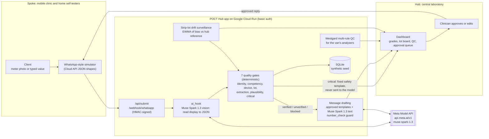

# ALAFIA POCT Hub

**Quality-assured point-of-care testing (POCT) that links a mobile clinic and its clients' home self-tests to a central laboratory, built for low-resource and rural settings.**

> **Research and decision-support only.** This is not a medical device and does not diagnose. The demo uses synthetic data only; no real patient data is used anywhere. A clinician approves every message before it reaches a client.

| | |
|---|---|
| **Live demo** | https://poct-hub-250296213348.europe-west1.run.app |
| **Login** | Given privately in the submission form. It is not in this repository. |
| **Health check (no login)** | https://poct-hub-250296213348.europe-west1.run.app/health |
| **Meta model** | Muse Spark 1.3 (`muse-spark-1.3`) via the Meta Model API (`https://api.meta.ai/v1`), for both vision and text |
| **Stack** | Python 3.12, FastAPI, SQLAlchemy (SQLite in the demo), Google Cloud Run |
| **Tests** | 22 automated tests (`pytest`) |

### Where to find each judging criterion

| Official criterion (weight) | Read |
|---|---|
| **Impact (30%)** | [Problem and impact](#1-problem-and-impact-impact-30) |
| **Use of Meta AI Tooling (25%)** | [How Meta AI is used](#3-how-meta-ai-is-used-use-of-meta-ai-tooling-25) |
| **Technical Depth & Execution (20%)** | [Architecture](#2-architecture-technical-depth--execution-20), [Quality control](#4-quality-control-features-technical-depth--execution-20), [Safety](#5-safety-and-privacy-technical-depth--execution-20), [Tests](#8-tests) |
| **Demo (25%)** | [Live demo walkthrough](#6-live-demo-walkthrough-demo-25) |

The criteria and weights are from the hackathon's official Event Waiver ("Hackathon Judging Criteria").

---

## 1. Problem and impact (Impact, 30%)

**The problem.** Across Nigeria, the wider West African region and the Gulf, millions of people check their own glucose, haemoglobin, INR, cholesterol and HbA1c. They use home meters or get tested at mobile clinics. Almost nobody checks:

- the **device** (is it verified and on-label?),
- the **strip lot** (heat-damaged, expired or drifting?), or
- the **reading** (read correctly? plausible? critical?).

A wrong number can lead to a wrong insulin dose, a missed anaemia or an unsafe anticoagulation decision. In rural areas the nearest laboratory may be hours away. In Nigeria, 78.7% of adults with diabetes are undiagnosed (IDF Diabetes Atlas 2024).

**What ALAFIA POCT Hub does.** It applies laboratory quality management to testing outside the lab, using a hub-and-spoke model:

- **Spoke:** a mobile clinic van, plus registered clients who self-test at home. They send a photo of the meter display, or type the value.
- **Hub:** the central laboratory. It verifies devices, releases strip lots, watches every lot for drift across all clients at once, runs Westgard QC on the van's analysers, and gives clinical oversight.
- **Result:** each reading gets a transparent quality grade: **verified**, **unverified**, **blocked** or **critical**. The client then gets a plain-language, clinician-approved reply.

**Who benefits.**
- **Clients:** safer self-testing and faster feedback, without travelling to a laboratory.
- **Clinicians:** they see which results to trust.
- **Laboratory managers:** they find a bad strip lot centrally, before it harms many people.
- **Health programmes:** a repeatable hub-and-spoke model that any town with one laboratory and one van can copy.

**Why it could be used for real.** It builds on MedLabAI-QC, an existing laboratory QC engine. The Westgard module is taken directly from that project. The design follows established POCT governance: a POCT coordinator, device verification, lot release, competency and EQA.

---

## 2. Architecture (Technical Depth & Execution, 20%)



**Design principle: the AI reads and drafts; it never decides.** Only the deterministic gate module (`poct_hub/gates.py`) assigns a grade. If the Meta API is unavailable, the app fails safely: the photo counts as unreadable, messages fall back to fixed templates, and the demo keeps working.

**Code layout**

| Path | Purpose |
|---|---|
| `poct_hub/main.py` | FastAPI app: auth middleware, API, dashboard, simulator, WhatsApp webhook (HMAC) |
| `poct_hub/gates.py` | Seven quality gates and grading (pure functions) |
| `poct_hub/lots.py` | EWMA strip-lot drift surveillance (ok, watch, hold) |
| `poct_hub/westgard.py` | Westgard multi-rule engine, from MedLabAI-QC |
| `poct_hub/ai_hook.py` | Meta Model API client: vision extraction and message drafting, with a stub fallback |
| `poct_hub/meter_png.py` | Draws the synthetic meter as PNG (the Model API does not accept SVG) |
| `poct_hub/db.py` | SQLAlchemy schema |
| `seed_synthetic.py` | Synthetic clinics, clients, devices, lots (including one drifting lot) and QC history |
| `tests/` | 22 pytest tests |
| `Dockerfile`, `DEPLOY-CLOUDRUN.md` | Container and Cloud Run deployment guide |

---

## 3. How Meta AI is used (Use of Meta AI Tooling, 25%)

### Running in the live demo

| Task | Model and call | Guardrails |
|---|---|---|
| **Read the meter display from a photo** | `muse-spark-1.3`, image input via `POST https://api.meta.ai/v1/chat/completions` (OpenAI-compatible). The image is sent as a data URL. Output is forced into a strict JSON schema with `response_format: json_schema`: `legible`, `value`, `unit`, `error_code`, `confidence`. | Low confidence or unreadable → "retake photo"; a photo/typed-value mismatch is flagged. The client must confirm the read-back (gate G5). The reading never sets the grade. |
| **Draft the client reply** | `muse-spark-1.3`, text. It rewords an **approved template** in plain language. | `number_check`: if the draft adds or changes any number, it is replaced by the template. Critical results are **never** sent to the model. A clinician approves every message. |
| **Key check** | `GET /api/ai/ping` (behind login): one tiny live call. | Returns only ok or an HTTP status; it never returns or logs the key. |

Settings follow the Meta Model API docs (https://dev.meta.ai/docs):
- Bearer-key authentication; the key is kept in Google Secret Manager.
- Temperature is left at its default; `reasoning_effort` is `low`; `max_completion_tokens` is set.
- The non-training `muse-spark-1.3` model is used, not the `-contributor` variant.

What goes beyond a basic integration:
- **Vision feeds a safety system:** structured output feeds deterministic laboratory-grade gates.
- **The model's output is checked:** schema validation plus the number guard.
- **Fail-safe design:** the app still works if the model is unavailable.

### Roadmap (designed, not in this build)

These are in the project design but **are not implemented in the deployed demo**:

- **SAM 3.1:** find and crop the meter display, so only a crop of the screen leaves the clinic, never the full photo.
- **Muse Image 1.0:** synthetic training photos and illustrated job aids (English, Pidgin, Arabic).
- **Muse Voice Transcribe:** voice-note result intake for clients with low literacy.
- **Open-weights model on-premises:** offline fallback for rural sites without connectivity.

---

## 4. Quality-control features (Technical Depth & Execution, 20%)

**Seven quality gates** (`poct_hub/gates.py`). Each submission is graded **verified**, **unverified**, **blocked** or **critical**:

| Gate | Checks |
|---|---|
| G1 Identity and consent | Known, active client; second identifier (birth year); service, messaging and AI-assist consent |
| G2 Competency | Self-test training current; lockout after repeated lapses |
| G3 Device | Registered, on-label for the test and purpose (off-label use is blocked), verification within 6 months; HbA1c devices must be **NGSP-certified** |
| G4 Strip lot | Released and in date, open-vial stability, **not on drift hold** |
| G5 Extraction | Photo readable, confidence ≥ 0.80, matches the typed value, client confirmed the read-back |
| G6 Plausibility | Correct unit, reportable range, device error codes, delta check against the last verified result |
| G7 Critical | Clinic-configurable critical limits → critical pathway |

**Five-test menu:** glucose, haemoglobin, INR, total cholesterol and HbA1c. Each has its own unit, reportable range, critical limits and delta rule. The default limits are placeholders for each clinic to set.

**Strip-lot drift surveillance** (`poct_hub/lots.py`):
- Paired checks (device against hub reference) feed an EWMA of % bias.
- Each lot moves **ok → watch → hold** against control limits and the allowable total error.
- Once a lot is on hold, every client using it is blocked at G4. One drifting lot is found centrally for everyone at once; the seed includes one (`LOT-G-2611B`).

**Westgard multi-rule QC** (`poct_hub/westgard.py`, from MedLabAI-QC):
- Rules for the van's analysers: 1-2s (warning), 1-3s, 2-2s, R-4s, 4-1s and 10-x (8-x is optional).
- Shown per analyser and test on the dashboard.

**HbA1c caution:**
- **In this build:** HbA1c is accepted only from NGSP-certified devices (G3).
- **In the design, not yet in code:** an enrolment warning that HbS, HbC and HbF variants (common in Nigeria) can make some HbA1c methods falsely reassuring, with fructosamine or a variant-tolerant method as the alternative.

**Alignment with ISO 15189:2022 (including Annex A on POCT).** The design maps to the standard's requirements as follows:

| Requirement | Where it shows up |
|---|---|
| POCT governance | Hub-led oversight and the dashboard |
| Personnel competency | G2 |
| Equipment verification | G3 |
| Reagent and consumable acceptance | G4 and lot release |
| Internal QC | Westgard |
| Result review and critical-result reporting | G6 and G7, with clinician approval |
| Traceability | Every gate result is stored with the submission |

This is **alignment by design, not accreditation or certification**.

---

## 5. Safety and privacy (Technical Depth & Execution, 20%)

- **Synthetic data only.** Every client, device, lot and reading is generated by `seed_synthetic.py` ("Demo Client A", etc.). The demo resets on each restart.
- **Research and decision-support only.** This label is on every page and in every message. The app gives no diagnosis or treatment advice.
- **Critical results never go to the model.** They trigger a fixed, pre-approved safety template and alert a clinician.
- **Humans in the loop.**
  - AI drafts sit in an approval queue; nothing is sent until a clinician approves.
  - The AI never sets a grade.
- **Authentication.** Basic auth protects every page except `/health` and the signed webhook.
  - Without a configured password, the app fails closed.
  - The WhatsApp webhook verifies the `X-Hub-Signature-256` HMAC and returns 503 when no secret is set.
- **Secrets.** The dashboard password and the Meta API key live in Google Secret Manager. None are in the code or this repository, and the key is never logged.
- **Data sent to Meta.** Only synthetic meter images and de-identified context go to the Model API. A real deployment would crop the display first (SAM 3.1, roadmap) and needs a data-protection assessment for cross-border transfer.

---

## 6. Live demo walkthrough (Demo, 25%)

Open https://poct-hub-250296213348.europe-west1.run.app and log in with the credentials from the submission form.

1. **Dashboard (`/`):** recent submissions with their grades, the strip-lot board (ok, watch, hold), the Westgard QC status and the message approval queue.
2. **Simulator (`/simulator`):** acts as a client on a WhatsApp-style phone. Try these:

| Input | Expected result |
|---|---|
| Client `C-001`, lot `LOT-G-2610A`, synthetic meter photo | **verified**: Muse Spark reads the display; reply drafted for approval |
| Client `C-002`, lot `LOT-G-2611B` | **blocked**: strip lot on hold for drift |
| Typed glucose `2.1` | **critical**: fixed safety template, never sent to the AI |

3. **Approve** a drafted message on the dashboard and watch it arrive in the simulator.
4. **`/health`** shows whether the live Meta model is active (`"ai_mode":"meta"`).

---

## 7. Run locally and deploy

### Run locally (Windows Command Prompt)

```bat
python -m venv .venv
.venv\Scripts\activate
pip install -r requirements-dev.txt
set DATABASE_URL=sqlite:///poct_hub.db
set DASHBOARD_USER=demo
set /p DASHBOARD_PASSWORD=Choose a local password: 
uvicorn poct_hub.main:app --port 8080
```

- Open http://localhost:8080 and log in as `demo`.
- Synthetic data is seeded on first start.
- Without `META_API_KEY`, the AI runs in a deterministic **stub** mode, so no key is needed to try it.

To use the real model locally, type your Meta key at this prompt:

```bat
set META_API_BASE=https://api.meta.ai/v1
set /p META_API_KEY=Meta API key: 
```

### Deploy to Google Cloud Run

`DEPLOY-CLOUDRUN.md` has the full step-by-step Windows CMD guide, including:
- enabling the APIs,
- storing secrets in Secret Manager,
- the deploy command,
- verification and rollback.

The deploy command it uses:

```bat
gcloud run deploy poct-hub --source . --region europe-west1 ^
  --allow-unauthenticated --min-instances 0 --max-instances 1 --memory 512Mi --cpu 1 ^
  --set-env-vars DASHBOARD_USER=demo,SEED_ON_START=true,META_API_BASE=https://api.meta.ai/v1,META_VISION_MODEL=muse-spark-1.3,META_TEXT_MODEL=muse-spark-1.3 ^
  --set-secrets DASHBOARD_PASSWORD=poct-dashboard-password:latest,META_API_KEY=meta-api-key:latest
```

---

## 8. Tests

```bat
pip install -r requirements-dev.txt
python -m pytest -q
```

The 22 tests cover:
- each of the seven gates and the grading, including that critical results skip the AI;
- the EWMA strip-lot drift states (ok, watch, hold) and the Westgard rules engine;
- `number_check`, which catches numbers the AI invented, and the stub extractor;
- the end-to-end submission flow;
- basic auth: protected pages return 401, `/health` and the webhook stay open, and the app fails closed without a password;
- the Meta client, offline with a fake key:
  - the exact endpoint, Bearer header, model id and PNG image payload;
  - the schema fallback; 401 and timeout failures fail safely;
  - the key never appears in output or logs;
  - critical results never reach the model.

---

## 9. Roadmap

1. **SAM 3.1** cropping of the display, so only the crop is sent to the cloud.
2. **Muse Image** job aids and a larger synthetic photo set, including glare, blur and error-code cases.
3. **Voice-note intake** (Muse Voice Transcribe), with read-back.
4. **HbA1c haemoglobin-variant** enrolment screen and warning.
5. A real **WhatsApp Cloud API** number and Messenger, behind a WAF.
6. **PostgreSQL** with row-level security; FHIR export; a POCT1-A or ASTM device gateway.
7. An offline **open-weights** fallback for rural sites.
8. Clinic-configured critical limits and allowable-error targets, with each clinic validating its own.

---

## 10. Licence

**TBD: the licence has not yet been chosen** (for example MIT or Apache-2.0). Until a licence is added, all rights are reserved by the author.

---

*ALAFIAAI / EEHLSS. Built for the Meta Global AI Developer Hackathon (November 2026). Research and decision-support only. Synthetic data only.*
